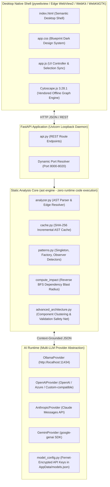

# CodeStruct

> **A Native Desktop Static Analysis Platform & Architectural Intelligence Environment for Python**

CodeStruct is an offline-first desktop application that statically parses Python codebases into interactive architecture graphs, sortable symbol tables, design-pattern catalogs, change-impact blast radiuses, and AI-synthesized architectural component clusters. The AI layer is **provider-agnostic**: connect a local Ollama runtime **or** any cloud model (OpenAI, Anthropic Claude, Google Gemini, Azure OpenAI, or any OpenAI-compatible endpoint) via the built-in Settings manager with encrypted API key storage.

Analysis is **100% static** — powered exclusively by Python's standard library `ast` module. **No code from analyzed projects is ever executed, evaluated, or imported**, ensuring total safety when inspecting untrusted or arbitrary repositories.

---

## Download the Ready-Made Executable

No Python setup required — grab the prebuilt Windows desktop app directly:

| Download | Link | Size |
|---|---|---|
| **CodeStruct.exe (Windows x64)** | [`dist/CodeStruct.exe`](https://github.com/VSA-ABHINAV/CodeStruct/raw/master/dist/CodeStruct.exe) | ~37 MB |

**Direct link (copy/paste):**
`https://github.com/VSA-ABHINAV/CodeStruct/raw/master/dist/CodeStruct.exe`

> [!NOTE]
> - **Windows SmartScreen:** The executable is unsigned. Windows may show *"Windows protected your PC"* on first launch — click **More info → Run anyway**.
> - Config, AST cache, and logs are written to `%APPDATA%\CodeStruct` and `%LOCALAPPDATA%\CodeStruct` on first run — nothing is required next to the `.exe`.
> - **Other platforms:** build from source instead — see [Step-by-Step Environment Setup](#step-by-step-environment-setup) and [Building the Standalone Executable](#building-the-standalone-executable).
> - After downloading, rebuilds are only needed when a new version lands; re-download the file to update.

---

## Table of Contents

- [Download the Ready-Made Executable](#download-the-ready-made-executable)
- [Architectural Overview](#architectural-overview)
- [Prerequisite System Capabilities](#prerequisite-system-capabilities)
- [Mandatory System Notice: Local AI Runtime & Model](#mandatory-system-notice-local-ai-runtime--model)
- [Step-by-Step Environment Setup](#step-by-step-environment-setup)
- [Local AI Installation & Model Configuration](#local-ai-installation--model-configuration)
- [Multi-LLM Providers, API Keys & Model Settings](#multi-llm-providers-api-keys--model-settings)
- [First-Run Setup Wizard](#first-run-setup-wizard)
- [Execution Guide](#execution-guide)
- [Building the Standalone Executable](#building-the-standalone-executable)
- [Verification & Test Suite](#verification--test-suite)
- [Core Feature Tour](#core-feature-tour)
- [REST API Reference](#rest-api-reference)
- [Directory Structure & Functional Roles](#directory-structure--functional-roles)
- [Troubleshooting & Common Pitfalls](#troubleshooting--common-pitfalls)

---

## Architectural Overview

CodeStruct operates as a single unified desktop process combining a local FastAPI ASGI service running on loopback (`127.0.0.1`) and a native `pywebview` window. All fonts, styles, and graph libraries are vendored locally for complete offline operability.



### Architectural Guarantees
1. **Zero Execution of Analyzed Code:** Parsing uses Python's built-in `ast` module. Code is parsed into syntactic trees without invoking `exec`, `eval`, or dynamic `import`.
2. **Offline-First:** Fonts (Inter, JetBrains Mono) and Cytoscape.js are fully vendored in `codestruct/frontend/static/vendor/`. No runtime internet connection is required for core static analysis (cloud AI providers are optional and user-initiated).
3. **Deterministic Symbol Accounting:** The Phase 19 validation layer guarantees that every real symbol in the AST graph is accounted for in component clusters or in `unclustered_symbol_ids`. Any hallucinated IDs from the local LLM are dropped and logged.
4. **Resilient Port Binding:** Automatically detects if port `8000` is occupied (e.g., `[Errno 10048]`) and binds to the next available loopback port (`8001`–`8020`).
5. **Encrypted Credential Storage:** API keys are Fernet-encrypted (PBKDF2-HMAC-SHA256, 100,000 iterations, machine-GUID-bound) at rest in `%APPDATA%\CodeStruct\models.json`. Keys are never persisted, logged, cached, or returned in plaintext; error strings are automatically redacted.

---

## Prerequisite System Capabilities

Before initializing CodeStruct, ensure your host machine satisfies these baseline hardware and OS toolchain requirements:

| Component | Minimum Specification | Recommended Specification |
|---|---|---|
| **Operating System** | Windows 10/11 (64-bit), macOS 12+ (Intel/Apple Silicon), Linux (Ubuntu 20.04+, Debian 11+, Fedora 36+, Arch) | Windows 11, macOS 14+ (M-series), or modern Linux |
| **Python Toolchain** | Python `3.10` – `3.14` with `pip` and `venv` | Python `3.12` or `3.14` (Verified on `3.14.6`) |
| **Git** | Git `>= 2.30` | Git `>= 2.40` |
| **System Memory (RAM)** | **4 GB** (Core static analysis, graph, patterns, table view) | **8 GB – 16 GB** (Required for concurrent local LLM inference) |
| **Disk Storage** | **500 MB** (Repository, virtual environment, AST caches) | **+3.0 GB** (Ollama runtime + `qwen2.5-coder:3b` model weights) |
| **Desktop GUI Runtime** | Windows: Edge WebView2<br>macOS: Cocoa WebKit<br>Linux: WebKit2GTK 4.0/4.1 | Preinstalled on Windows 10/11 & macOS |

### OS-Specific System Dependencies (Install Before Python Setup)

- **Windows (10/11):**
  - Microsoft Edge WebView2 Runtime is built into Windows 10 (1803+) and Windows 11. On Windows Server / LTSC, install the [WebView2 Evergreen Runtime](https://developer.microsoft.com/en-us/microsoft-edge/webview2/).
  - Ensure [Python 3.10+](https://www.python.org/downloads/windows/) (with **"Add python.exe to PATH"** checked) and [Git for Windows](https://git-scm.com/download/win) are installed.

- **macOS (12+):**
  - Native Cocoa WebKit is built in; no extra GUI runtime is needed.
  - Install Xcode Command Line Tools and Python 3 if not already present:
    ```zsh
    xcode-select --install
    brew install python@3.12 git
    ```

- **Linux (Ubuntu / Debian / Fedora / Arch):**
  - On minimal Linux distributions, both Python's `venv` module and `pywebview`'s GTK/WebKit2GTK bindings must be installed via your system package manager:
    ```bash
    # Ubuntu 24.04+ / Debian 12+ (Bookworm/Trixie)
    sudo apt-get update && sudo apt-get install -y git python3 python3-venv python3-pip python3-gi gir1.2-webkit2-4.1 libgirepository1.0-dev

    # Ubuntu 20.04 / 22.04 / Debian 11 (uses webkit2-4.0)
    sudo apt-get update && sudo apt-get install -y git python3 python3-venv python3-pip python3-gi gir1.2-webkit2-4.0 libgirepository1.0-dev

    # Fedora / RHEL
    sudo dnf install -y git python3 python3-pip python3-gobject webkit2gtk4.1

    # Arch Linux
    sudo pacman -S --needed git python python-pip python-gobject webkit2gtk-4.1
    ```

---

## Mandatory System Notice: Local AI Runtime & Model

> [!WARNING]
> ### CRITICAL NOTICE: LOCAL OPEN-SOURCE AI MODEL DOWNLOAD & SYSTEM RESOURCE IMPACT
>
> CodeStruct includes an optional local AI chat assistant and an Advanced Architecture clustering synthesizer. You have **two AI provider paths**, both fully optional:
>
> 1. **Local Open-Source LLM (Ollama):** Download and execute an open-source neural network (`qwen2.5-coder:3b`) directly on your local CPU/GPU.
> 2. **Cloud Providers via API Key (OpenAI / Anthropic / Gemini / Azure / Custom):** No local model download — requests are sent to the provider's API using your own key, encrypted at rest locally (see [Multi-LLM Providers](#multi-llm-providers-api-keys--model-settings)).
>
> **If you choose the local Ollama path, the explicit implications are:**
> 1. **Disk Storage:** Pulling `qwen2.5-coder:3b` requires approximately **2.0 GB** of network bandwidth and allocates **~2.2 GB** of permanent disk space inside Ollama's local model store (`~/.ollama/models` on macOS/Linux or `%USERPROFILE%\.ollama\models` on Windows).
> 2. **Memory (RAM / VRAM) Footprint:** When loaded for inference, the model allocates between **3.0 GB and 4.5 GB** of system RAM (or dedicated GPU VRAM if CUDA, ROCm, or Apple Metal acceleration is available).
> 3. **Processor & Thermal Load:** Inference drives sustained multi-core CPU or GPU utilization, increasing thermal output, fan noise, and battery drain on portable devices.
>
> **Graceful Degradation Guarantee:**
> If your hardware lacks ~2.2 GB free disk space or 8+ GB total RAM — or you simply don't want to configure any AI — **skip both AI paths**. CodeStruct operates **100% reliably in degraded mode**: AST static parsing, interactive relationship graphs, symbol tables, Martin's Instability metrics, change-impact blast radius analysis, and design-pattern detection all work completely offline with zero loss of core capability. The Assistant dock will simply show an unobtrusive `Disconnected` badge.

---

## Step-by-Step Environment Setup

Execute the exact commands for your operating system and shell to deploy CodeStruct cleanly from a fresh clone.

### 1. Clone the Repository

Run the following in your terminal:

```bash
git clone https://github.com/VSA-ABHINAV/CodeStruct.git
cd CodeStruct
```

*(Note: If Phase 19/20 features are not yet merged into `master`, switch to the active feature branch: `git checkout feature/phase-19-20-tooling`)*

### 2. Create & Activate an Isolated Virtual Environment

- **Windows (PowerShell):**
  ```powershell
  python -m venv venv

  # Allow venv activation script in the current PowerShell session if restricted:
  Set-ExecutionPolicy -ExecutionPolicy RemoteSigned -Scope Process

  .\venv\Scripts\Activate.ps1
  ```

- **Windows (Command Prompt / CMD):**
  ```cmd
  python -m venv venv
  venv\Scripts\activate.bat
  ```

- **macOS / Linux (Bash or Zsh):**
  ```bash
  python3 -m venv venv
  source venv/bin/activate
  ```

*(Once activated, your shell prompt displays `(venv)`, and both `python` and `pip` point directly to your isolated environment across all operating systems.)*

### 3. Install Python Dependencies

With `(venv)` active, upgrade `pip` and install the requirements file:

```bash
python -m pip install --upgrade pip
pip install -r requirements.txt
```

### 4. Verify Package Integrity

Confirm zero dependency conflicts:

```bash
python -m pip check
```
*(Expected output: `No broken requirements found.`)*

---

## Local AI Installation & Model Configuration

*(Optional — skip this section if running without local AI features.)*

> [!CAUTION]
> **Resource Check Before Executing:** Confirm you have at least **2.5 GB free disk space** and **4.5 GB available RAM/VRAM** before pulling `qwen2.5-coder:3b`. See the [Mandatory System Notice](#mandatory-system-notice-local-ai-runtime--model) above.

### Step 1: Install Ollama Runtime

- **Windows (PowerShell or CMD via `winget`):**
  ```powershell
  winget install Ollama.Ollama
  ```
  *(Alternatively, download the GUI installer from [https://ollama.com/download/windows](https://ollama.com/download/windows). Restart your terminal after installation so `ollama` is on your `PATH`.)*

- **macOS (Bash/Zsh via Homebrew):**
  ```zsh
  brew install ollama
  ```
  *(Alternatively, download the macOS app from [https://ollama.com/download/mac](https://ollama.com/download/mac).)*

- **Linux (Bash):**
  ```bash
  curl -fsSL https://ollama.com/install.sh | sh
  ```

### Step 2: Start the Ollama Service Daemon

In a dedicated terminal window, start the local Ollama server (port `11434`):

```bash
ollama serve
```
*(On Windows/macOS, if you installed the desktop tray app and it is already running, `ollama serve` may report the address is already in use — that means the daemon is already active.)*

### Step 3: Pull the Model Weights (~2.0 GB Download / ~2.2 GB on Disk)

In your terminal, pull the CodeStruct target model:

```bash
ollama pull qwen2.5-coder:3b
```

### Step 4: Verify Model Availability

```bash
ollama list
```
*(Expected output lists `qwen2.5-coder:3b`.)*

> [!TIP]
> **Prefer a cloud model instead?** Skip the Ollama steps entirely and configure OpenAI / Anthropic / Gemini / Azure / Custom directly in the **Settings (⚙️) modal** or the **First-Run Setup Wizard** — see the next section.

---

## Multi-LLM Providers, API Keys & Model Settings

CodeStruct ships a full **Multi-LLM provider abstraction** (`llm_providers.py`, `llm_client.py`, `model_config.py`). You are not locked into Ollama — connect **any number of models** and switch between them at runtime.

### Supported Providers

| Provider key | Service | API Key Required | Extra Fields |
|---|---|---|---|
| `ollama` | Local Ollama runtime (`/api/chat`, `/api/tags`) | No | Base URL (default `http://localhost:11434`) |
| `openai` | OpenAI Chat Completions | **Yes** | Optional Base URL |
| `anthropic` | Anthropic Claude Messages API | **Yes** | Optional Base URL |
| `gemini` | Google Gemini (`google-genai` SDK) | **Yes** | — |
| `azure` | Azure OpenAI Deployments | **Yes** | Base URL/Endpoint, Deployment Name, API Version (e.g. `2024-06-01`) |
| `custom` | Any OpenAI-compatible endpoint (LM Studio, vLLM, OpenRouter, etc.) | Optional (some local servers need none) | Base URL |

### The Settings (⚙️) Modal — "LLM Providers & Model Settings"

Open via the gear button in the header. The modal provides complete model lifecycle management:

- **Configured model cards** showing provider badge, display name, model ID, masked key, base URL, and enabled status.
- **`+ Add Model` / Edit** — a dynamic form that adapts per provider (API-key field hidden for Ollama; Deployment Name & API Version shown only for Azure; Base URL hidden for Gemini).
- **Test Connection** — validates connectivity/auth against the provider and reports how many models are reachable (never exposes credentials).
- **Set Chat / Set Arch** — set the model as default for **AI Chat**, **Architecture Clustering**, or both. Defaults are enforced uniquely (only one default per feature at a time).
- **Delete** — removes the configuration; defaults are automatically re-assigned to the first remaining model.
- **Enable/Disable** toggle — disabled models are excluded from resolution and chat requests.

### Model Selectors in the Workspace

- **AI Assistant dock header:** a chat-model dropdown listing all enabled models (defaults preselected), switchable per session.
- **Architecture tab header:** an architecture-model dropdown used for the LLM component-clustering request (with optional per-request `model_id` override via the REST API).

### Encrypted API Key Storage (Security Model)

All API keys are **encrypted at rest** — never written to disk, logs, cache, or API responses in plaintext:

1. A stable host-machine identifier is resolved (Windows `MachineGuid` registry key, Linux `/etc/machine-id`, macOS `IOPlatformUUID`, with a deterministic fallback).
2. A Fernet key is derived via **PBKDF2-HMAC-SHA256 with 100,000 iterations** and a per-secret random 16-byte salt.
3. Keys are stored as `enc:v1:<salt>:<fernet-token>` blobs inside `%APPDATA%\CodeStruct\models.json`.
4. Decryption **refuses plaintext** blobs; every returned API view exposes only `has_key` and a masked key (e.g. `sk-****abcd`).
5. Exception strings and logs are automatically redacted (`***REDACTED***`) so keys can never leak through error messages.

### First-Class Migration & Resolution Rules

- On first launch, any existing Ollama configuration (`config.json` → `ollama_host` / `ollama_model`) is **auto-migrated** into `models.json` as the `ollama-default` record.
- Chat and Architecture requests resolve their target model in order: explicit `model_id` → feature default → first enabled model.
- Cloud requests missing a decrypted key fail fast with a friendly `[Error]` directing you to Settings — no network call is attempted.

---

## First-Run Setup Wizard

On launch, the **⚡ Setup & System Readiness wizard** can be opened from the header. It provides a guided, fully in-app onboarding experience:

### 1. System Readiness Checks (live, with ↻ Recheck)
- OS, architecture, and frozen-executable detection
- Total & available RAM (with static-analysis and AI thresholds)
- Free disk space for both the AST cache dir and the target model storage dir
- Microsoft Edge WebView2 runtime detection (Windows) with version
- Ollama executable discovery (PATH + standard install paths), daemon running state, and whether `qwen2.5-coder:3b` is pulled
- `winget` availability; summary of config path and cache directory

### 2. Mandatory Resource Warning
The same disk/RAM/thermal impact notice as above, inline, with the graceful-degradation note.

### 3. Choose AI Provider (Optional)
- **Local Ollama panel:**
  - Custom model storage directory (`OLLAMA_MODELS`) with a **native folder picker** (via pywebview; falls back to typing a path in browser mode) and live free-space check on the target drive.
  - **⬇️ Install Ollama Runtime** — silent `winget install Ollama.Ollama` in a background thread with a live streaming task log; falls back to opening the official download page on failure.
  - **📥 Pull qwen2.5-coder:3b** — starts the Ollama daemon (if needed) with your custom model path, streams `ollama pull` progress, and persists the resulting config automatically.
- **Cloud Provider panel:** pick OpenAI / Anthropic / Gemini / Azure / Custom, enter model name, API key, and (for Azure/Custom) the endpoint. Keys are encrypted immediately on save.
- **Footer:** **Skip AI — Static Analysis Only** (fully functional degraded mode) or **Save Configuration & Launch**.

All wizard selections persist to `%APPDATA%\CodeStruct\config.json` (`first_run_completed`, `ai_enabled`, `ollama_model`, `ollama_models_dir`).

---

## Execution Guide

### Launching CodeStruct (Native Desktop Window)

Ensure your virtual environment `(venv)` is active and run from the repository root:

```bash
python run.py
```

### Startup Behavior:
1. FastAPI initializes and probes `http://localhost:11434/api/tags` (1-second timeout).
2. `find_available_port()` selects port `8000`, automatically falling back through `8001`–`8020` if occupied.
3. Uvicorn runs the local backend server in a background daemon thread.
4. `pywebview` opens the 1280×800 native desktop window.
5. On first run (or anytime via the header), the **⚡ Setup Wizard** is available to run system checks and configure AI (local Ollama or cloud API keys) — or skip AI entirely.

### Analyzing Codebases:
- **Bundled Sample Project:** Click **Analyze** directly (leaving the path field empty or as `sample_project`) to inspect the built-in 16-node `sample_project/sample_project.py` fixture.
- **Any Local Repository:** Enter an absolute path (e.g., `C:\projects\my_repo` on Windows or `/Users/name/my_repo` on macOS/Linux) or a relative path, then click **Analyze**.

### Headless / Web Browser Mode (Alternative to Native Window):
If deploying on a headless server or preferring a standard browser over `pywebview`:

```bash
# Run from the repository root (note --app-dir codestruct is required):
python -m uvicorn backend.main:app --app-dir codestruct --host 127.0.0.1 --port 8000
```
Then open `http://127.0.0.1:8000` in your browser.

---

## Building the Standalone Executable

CodeStruct can be packaged into a **single standalone Windows executable** via PyInstaller:

```bash
python build_exe.py
```

- Uses the `CodeStruct.spec` PyInstaller spec at the repository root.
- Produces `dist/CodeStruct.exe` with bundled frontend assets and the sample project (asset paths resolve via `sys._MEIPASS` when frozen).
- The build script fails hard if the output exceeds a **150 MB size budget**.
- Config, cache, and logs still live in the user profile directories (`%APPDATA%\CodeStruct`, `%LOCALAPPDATA%\CodeStruct`) — not inside the executable folder.

---

## Verification & Test Suite

With `(venv)` active at the repository root, run the automated verification suites.

### Run Complete Regression Suite (78 Tests)

```bash
python -m pytest -v
```
*(Expected output: `78 passed` covering AST analysis, FastAPI routes, cache invalidation, pattern heuristics, Phase 19 LLM validator safety net, Multi-LLM provider & encrypted storage, configuration & wizard, and Phase 20 SUS scoring.)*

### Run Individual Targeted Test Modules

```bash
# 1. Core AST Parser & Edge Extractor (7 tests)
python -m pytest -v codestruct/tests/test_analyzer.py

# 2. FastAPI Endpoints, Pygments Code Slices & Instability Metrics (25 tests)
python -m pytest -v codestruct/tests/test_api.py

# 3. Incremental Cache Hits & File Modification/Deletion Invalidation (4 tests)
python -m pytest -v codestruct/tests/test_cache.py

# 4. Design Pattern Heuristics: Singleton, Factory & Observer (8 tests)
python -m pytest -v codestruct/tests/test_patterns.py

# 5. Advanced Architecture Clustering & Validation Safety Net (8 tests)
python -m pytest -v codestruct/tests/test_advanced_architecture.py

# 6. Configuration & First-Run Wizard Tests (5 tests)
python -m pytest -v codestruct/tests/test_config_and_wizard.py

# 7. Multi-LLM Provider & Key Encryption Tests (8 tests)
python -m pytest -v codestruct/tests/test_multi_llm.py

# 8. Usability Study SUS Formula Unit Tests (13 tests)
python -m pytest -v docs/usability_study/test_score.py
```

---

## Core Feature Tour

### 1. Interactive Graph View (`Graph` Tab)
- **Cytoscape Canvas:** Interactive visualization of `module`, `class`, `function`, and `method` nodes.
- **Directed Edge Types:** `inherits` (inheritance), `defines` (containment), `constructs` (instantiation), and `calls` (invocations).
- **Controls:** Pan, zoom, fit to viewport, toggle layout (dagre vs cose), and filter checkboxes by node kind.

### 2. Tabular Symbols View (`Table` Tab)
- Multi-column sortable table listing every extracted symbol (Name, Kind, Module, File, Start Line, End Line).
- Clicking any row synchronizes focus across Explorer, Graph, and Inspector.

### 3. Design Patterns (`Patterns` Tab)
- Pure AST structural heuristics for **Singleton**, **Factory**, and **Observer** patterns.
- Displays exact AST heuristic evidence strings alongside a permanent disclaimer noting heuristic detection rather than guaranteed design intent.

### 4. Read-Only Code Viewer (`Code` Tab)
- Syntax-highlighted source slice rendered server-side via Pygments (`one-dark` theme) with ±5 lines of surrounding context.
- **Open in Editor:** Launches the file externally via your OS default handler (`os.startfile` on Windows, `open` on macOS, `xdg-open` on Linux).

### 5. Advanced Architecture (`Architecture` Tab)
- Groups symbols into architectural component clusters with assigned roles, rationales, and a project-level narrative.
- **Validation Safety Net:** Drops and logs any hallucinated symbol IDs; recovers omitted real symbols into `Unclustered Symbols`.
- **Cross-Navigation:** Clicking any component switches to `Graph` view, highlights its member symbols, and loads the primary symbol in Inspector.

### 6. Collapsible 4-Dock Workspace
- **Explorer (Left):** Instant symbol filter tree; collapses to a 40px rail.
- **Inspector (Right Top):** Fan-in, fan-out, Robert C. Martin's Instability ($I = \frac{\text{fan-out}}{\text{fan-in} + \text{fan-out}}$), docstrings, relationships, and transitive change-impact blast radius; collapses to a 40px rail.
- **AI Assistant (Right Bottom):** Context-aware AI chat (any configured provider) automatically receiving selected symbol metadata and source slices, with a chat-model selector dropdown; collapses to a 40px rail.
- **Status & Logs (Bottom):** Real-time timings, parse warnings, and system alerts.

### 7. LLM Providers & Model Settings (⚙️ Modal)
- Add / edit / delete any number of model configurations across **Ollama, OpenAI, Anthropic (Claude), Google Gemini, Azure OpenAI, and Custom OpenAI-compatible** endpoints.
- **Test Connection** per model with reachability report; enable/disable toggles; separate **Default Chat** and **Default Architecture** assignments.
- All API keys are **Fernet-encrypted at rest** (PBKDF2-HMAC-SHA256, 100k iterations, machine-GUID-bound) in `%APPDATA%\CodeStruct\models.json`, shown only as masked keys (e.g. `sk-****abcd`) and redacted from all errors and logs.

### 8. First-Run Setup Wizard (⚡)
- Live system readiness diagnostics (RAM, disk, WebView2, Ollama detection, winget availability) with a recheck button.
- One-click **Ollama install via winget** and **model pull** (custom `OLLAMA_MODELS` directory with native folder picker) running as background tasks with streaming logs.
- Alternative **cloud provider setup** (provider, model, API key, endpoint) directly in the wizard.
- **Skip AI** for a pure static-analysis install; all choices persist to `%APPDATA%\CodeStruct\config.json`.

---

## REST API Reference

Endpoints exposed on `http://127.0.0.1:<port>`:

| Method | Endpoint | Request Body / Query | Response Model | Description |
|---|---|---|---|---|
| `POST` | `/api/analyze` | `{"project_path": "...", "force_refresh": false}` | `Graph` | Parses project or single `.py` file and caches graph state. |
| `GET` | `/api/symbol/{node_id}` | *Path param:* `node_id` | `SymbolDetail` | Symbol metadata, relationships, fan-in/out, and instability. |
| `GET` | `/api/source` | `?file_path=...&start=1&end=50` | `SourceResponse` | Pygments syntax-highlighted HTML slice. |
| `GET` | `/api/impact/{node_id}` | `?max_depth=5` | `ImpactResponse` | Reverse dependency blast radius via BFS. |
| `GET` | `/api/patterns` | *None* | `PatternsResponse` | Detected Singleton, Factory, and Observer matches. |
| `POST` | `/api/architecture/advanced` | `{"force_refresh": false, "model_id": "..."}` | `AdvancedArchitectureResponse` | Validated LLM component clustering via the default (or specified) architecture model. |
| `POST` | `/api/open_in_editor` | `{"file_path": "..."}` | `OpenInEditorResponse` | Opens file in OS default external editor. |
| `POST` | `/api/llm/chat` | `{"message": "...", "context_symbol_id": "...", "model_id": "..."}` | `ChatResponse` | Context-grounded chat with **any configured provider** (default chat model if `model_id` omitted). |
| `POST` | `/api/qwen/chat` | *(deprecated alias)* | `ChatResponse` | Backward-compatible alias for `/api/llm/chat`. |
| `GET` | `/api/qwen/status` | *None* | `{"status", "model", "display_name", "provider"}` | Checks the active default chat model's connectivity (provider-aware; Ollama probe when applicable). |
| `GET` | `/api/models` | *None* | `ModelListResponse` | Lists all configured models with **masked keys only**. |
| `POST` | `/api/models` | `ModelConfigCreate` (provider, model, key, base URL, deployment, defaults…) | `ModelConfigPublic` | Adds/updates a model config; API key is Fernet-encrypted on write. |
| `DELETE` | `/api/models/{model_id}` | *Path param:* `model_id` | `{"deleted": true}` | Deletes a configured model (defaults re-assigned). |
| `POST` | `/api/models/{model_id}/validate` | *Path param:* `model_id` | `ValidateModelResponse` | Tests provider connectivity/auth; returns reachable model list. |
| `POST` | `/api/models/{model_id}/set-default` | `{"target": "chat" \| "architecture" \| "both"}` | `ModelConfigPublic` | Sets the default model for chat, architecture clustering, or both. |
| `GET` | `/api/wizard/status` | `?models_dir=...` | *System checks JSON* | Live hardware/OS/WebView2/Ollama readiness checks + config + background task state. |
| `POST` | `/api/wizard/complete` | `{"ai_enabled", "ollama_model", "ollama_models_dir"}` | *Config JSON* | Persists wizard selections to `%APPDATA%\CodeStruct\config.json`. |
| `POST` | `/api/wizard/ollama/install` | *None* | `{"started": true}` | Background silent Ollama install via winget (or opens download page). |
| `POST` | `/api/wizard/ollama/pull` | `{"models_dir": "...", "model_name": "..."}` | `{"started": true}` | Starts daemon with custom `OLLAMA_MODELS` path and pulls the model. |
| `GET` | `/api/wizard/ollama/task_status` | *None* | *Task state JSON* | Live status + streaming log of ongoing install/pull task. |
| `POST` | `/api/wizard/browse_folder` | *None* | `{"selected", "supported"}` | Opens native folder picker (pywebview) for model storage path. |
| `GET` | `/` | *None* | `FileResponse` | Serves desktop application shell (`index.html`). |

---

## Directory Structure & Functional Roles

```text
CodeStruct/
├── run.py                                  # Root execution entrypoint
├── requirements.txt                        # Universal pinned dependencies & local AI setup notice
├── README.md                               # Zero-friction onboarding & operational guide
├── CodeStruct_Project_Plan.md              # Master technical specification & data contracts
├── build_exe.py                            # PyInstaller build script (standalone Windows exe, 150 MB budget)
├── CodeStruct.spec                         # PyInstaller spec for the frozen desktop bundle
├── codestruct/
│   ├── run.py                              # Package-level secondary wrapper
│   ├── requirements.txt                    # Synchronized requirements file
│   ├── README.md                           # Synchronized package README
│   ├── backend/
│   │   ├── __init__.py                     # Package marker
│   │   ├── main.py                         # FastAPI lifecycle, port fallback & pywebview window
│   │   ├── api.py                          # REST route endpoints (analysis, chat, models, wizard)
│   │   ├── analyzer.py                     # AST parser, edge extraction & change-impact BFS
│   │   ├── cache.py                        # Incremental SHA-256 AST disk cache manager
│   │   ├── config.py                       # AppData/LocalAppData persistence & PyInstaller asset resolution
│   │   ├── llm_client.py                   # Multi-LLM query interface & context prompt builder
│   │   ├── llm_providers.py                # Ollama / OpenAI / Anthropic / Gemini / Azure / Custom providers
│   │   ├── model_config.py                 # Encrypted API key storage (Fernet) & ModelRegistry CRUD
│   │   ├── patterns.py                     # Singleton, Factory, Observer heuristic detectors
│   │   ├── qwen_client.py                  # Legacy Ollama client (preserved for mock compatibility)
│   │   ├── advanced_architecture.py        # Component clustering, validation net & caching
│   │   ├── schemas.py                      # Pydantic v2 models & validation contracts
│   │   └── wizard.py                       # First-run system checks, winget install & model pull tasks
│   ├── frontend/
│   │   ├── index.html                      # Desktop semantic shell, 4-dock workspace, Settings & Wizard modals
│   │   └── static/
│   │       ├── app.js                      # UI controller, Cytoscape renderer, selection sync, Model Manager
│   │       ├── app.css                     # Blueprint dark theme stylesheet & icon rails
│   │       └── vendor/                     # Vendored offline assets (zero CDN dependencies)
│   │           ├── cytoscape.min.js        # Cytoscape.js 3.28.1
│   │           └── fonts/                  # Inter & JetBrains Mono WOFF2 fonts
│   ├── sample_project/
│   │   └── sample_project.py               # Fixed 16-node test fixture (do not modify)
│   └── tests/
│       ├── test_analyzer.py                # AST extraction unit tests
│       ├── test_api.py                     # API integration tests
│       ├── test_cache.py                   # Cache hit & modify/delete invalidation tests
│       ├── test_config_and_wizard.py       # Configuration & wizard unit tests
│       ├── test_multi_llm.py               # Multi-LLM provider & encryption tests
│       ├── test_patterns.py                # Pattern heuristic fixture & negative control tests
│       ├── test_advanced_architecture.py   # LLM validator safety net & retry tests
│       ├── cache_fixtures/                 # 2-file cross-file invalidation fixture
│       └── pattern_fixtures/               # Singleton/Factory/Observer example fixtures
├── docs/
│   └── usability_study/                    # Phase 20 Usability Study Tooling
│       ├── questionnaire.html              # Offline 10-item SUS questionnaire
│       ├── score.py                        # SUS & rubric computation script
│       ├── test_score.py                   # 13 SUS unit tests
│       ├── results.md                      # Study reporting template
│       └── raw_data/                       # Participant JSON-lines schema & data directory
├── dist/                                   # PyInstaller output (CodeStruct.exe)
└── User Profile Storage (generated at runtime):
    ├── %APPDATA%\CodeStruct\config.json    # Persisted app configuration & wizard selections
    ├── %APPDATA%\CodeStruct\models.json    # Model registry with Fernet-encrypted API keys
    ├── %LOCALAPPDATA%\CodeStruct\cache\    # Incremental AST disk cache
    └── %LOCALAPPDATA%\CodeStruct\logs\     # Runtime logs
```

---

## Troubleshooting & Common Pitfalls

### 1. Port Already in Use (`[Errno 10048]` on Windows / `[Errno 98]` on Linux/macOS)
- **Cause:** Another process is already bound to port `8000`.
- **Solution:** Launching via `python run.py` resolves this automatically via `find_available_port()`, binding to `8001`–`8020`. If running Uvicorn directly in headless mode, pass an alternate port:
  ```bash
  python -m uvicorn backend.main:app --app-dir codestruct --host 127.0.0.1 --port 8080
  ```

### 2. PowerShell Script Execution Policy (`PSSecurityException`)
- **Cause:** Windows PowerShell blocks unsigned scripts by default, preventing `.\venv\Scripts\Activate.ps1`.
- **Solution:** Run `Set-ExecutionPolicy -ExecutionPolicy RemoteSigned -Scope Process` in your PowerShell session before activating the virtual environment.

### 3. `ModuleNotFoundError: No module named 'backend'` When Running Uvicorn
- **Cause:** Running Uvicorn directly from root without `--app-dir codestruct`.
- **Solution:** Always run `python run.py` or pass `--app-dir codestruct` to Uvicorn:
  `python -m uvicorn backend.main:app --app-dir codestruct --host 127.0.0.1 --port 8000`

### 4. AI Assistant Shows `Disconnected`
- **Cause (Ollama):** Ollama service is not running on port `11434`.
- **Solution:** Start `ollama serve` in a terminal, pull the model (`ollama pull qwen2.5-coder:3b`), and verify `ollama list`. Or switch to a cloud provider: open **Settings (⚙️)**, add an OpenAI / Anthropic / Gemini / Azure / Custom model with its API key, and set it as **Default Chat**.

### 5. Cloud Model Fails with `[Error] Missing or unreadable API key`
- **Cause:** The configured cloud model has no stored key, or the key cannot be decrypted on this machine (encrypted blobs are machine-bound and do not transfer between computers).
- **Solution:** Open **Settings (⚙️)**, edit the model, and re-enter the API key. Keys are re-encrypted with the current machine's identifier on save.

### 6. Linux `pywebview` Fails to Open Window
- **Cause:** Missing GTK/WebKitGTK bindings or running on a headless SSH session without `$DISPLAY`.
- **Solution:** Install GTK/WebKit system packages (`sudo apt-get install -y python3-gi gir1.2-webkit2-4.1`), or launch in headless browser mode via Uvicorn and forward port `8000`.

### 7. Target Project Has Syntax Errors
- **Behavior:** CodeStruct catches `SyntaxError` safely per file, records the diagnostic in `errors`, displays a warning in Status/Logs, and still graphs all valid files.

---

## License

CodeStruct is open-source software licensed under the MIT License.
